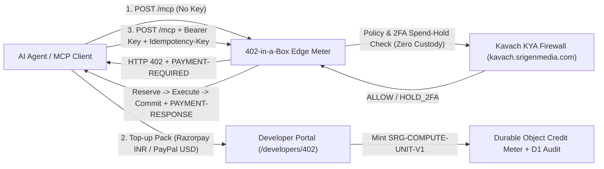

# 402-in-a-Box — HTTP 402 Metering & Compute Packs for MCP

[](https://mcptry.com/servers/io.github.srigenmedia/402-in-a-box)

Turn any Model Context Protocol (`2026-07-28`) server into a pay-per-call metered API using **HTTP `402 Payment Required`**, atomic reserve-commit-rollback metering, and compliant fiat compute packs (**Razorpay INR 18% GST** & **PayPal USD 0% Export LUT**).

- **Live MCP Endpoint:** `https://mcp.vashishta.srigenmedia.com/mcp`
- **Agent Discovery Card:** `https://mcp.vashishta.srigenmedia.com/.well-known/agent.json`
- **Developer Portal & 25-Unit Free Sandbox:** `https://vashishta.srigenmedia.com/developers/402`
- **Kavach KYA Spend-Hold Firewall:** `https://kavach.srigenmedia.com`

## 3-Step Quickstart

### 1. Install the Clean-Room SDK
```bash
# TypeScript / Cloudflare Workers

[](https://mcptry.com/servers/io.github.srigenmedia/402-in-a-box)
npm install @srigenmedia/mcp-402

# Python / FastAPI / MCP

[](https://mcptry.com/servers/io.github.srigenmedia/402-in-a-box)
pip install srigen-mcp-402
```

### 2. Connect an MCP Client (`mcp_config.json`)
```json
{
  "mcpServers": {
    "vashishta-402": {
      "type": "streamable-http",
      "url": "https://mcp.vashishta.srigenmedia.com/mcp",
      "headers": {
        "Authorization": "Bearer ${MCP_402_API_KEY}"
      }
    }
  }
}
```

### 3. Run the 60-Second Terminal Demo
```powershell
$env:MCP_402_API_KEY = "<your-sandbox-key-from-portal>"
.\scripts\demo-402-flow.ps1
```

## Architecture: `402-in-a-Box` + `Kavach KYA`



## Compliance & Zero-Custody Posture
- **Closed-Loop SaaS Compute Units:** `SRG-COMPUTE-UNIT-V1` billed under **SAC `998315`** (non-withdrawable, non-transferable compute credits).
- **Taxation & Invoicing:** Razorpay **18% GST** (INR) and PayPal Orders v2 **0% Export LUT** (USD) with sequential GST/LUT tax receipts.
- **Indian Crypto Firewall:** `x402` on-chain facilitator verification is **disabled by default** (`X402_CRYPTO_ENABLED = false`) on Indian deployments (`opt-in` only for non-Indian self-hosters).
- **Kavach KYA (`₹0` Custody):** Stores only authorization policy state, `user_intent_hash`, `cart_mandate_hash`, and verified bank/gateway RRN/UTR proofs — holding `₹0` customer funds.
